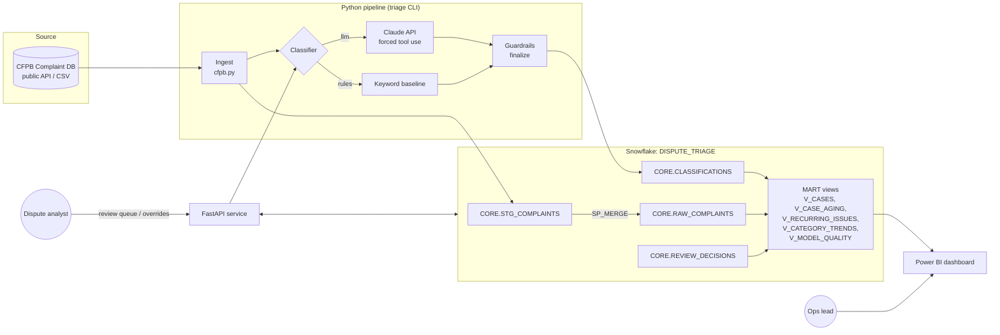
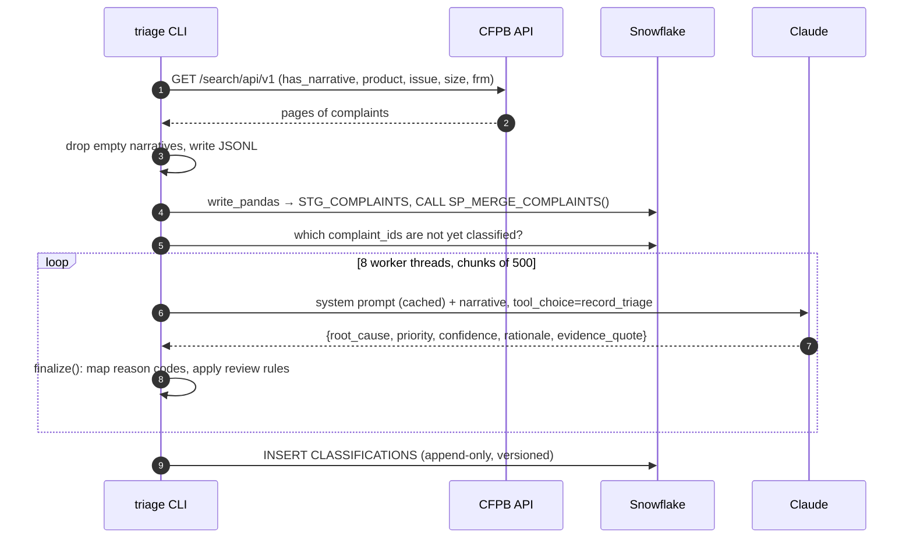
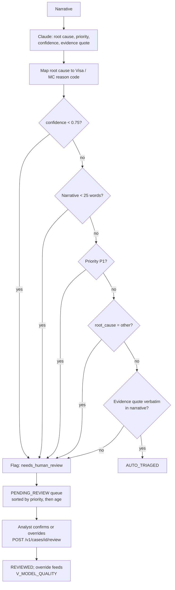
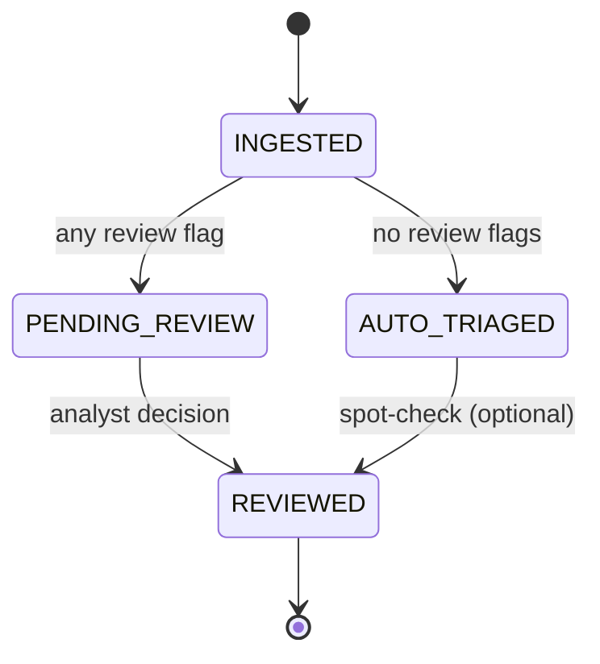
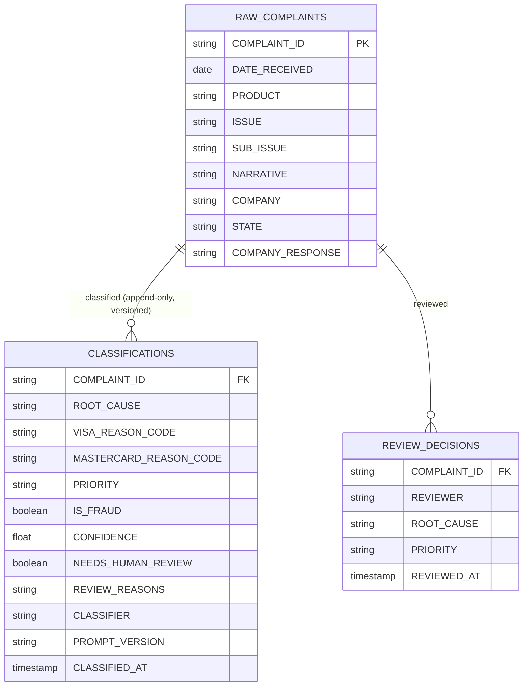
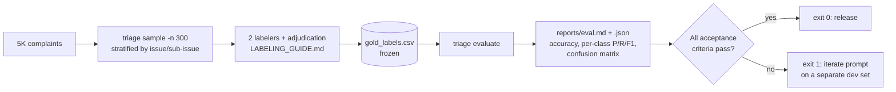

# Dispute Triage Copilot

**An LLM pipeline that triages public CFPB credit card dispute and fraud complaints by root cause, chargeback reason code, and escalation priority. Low-confidence outputs are routed to human review.**

`Python` · `FastAPI` · `Snowflake` · `SQL` · `Claude API` · `Power BI`

[](https://github.com/tanvisht/Card-Dispute-Handler-Agent/actions)

---

## Table of contents
1. [Problem](#1-problem)
2. [What it does](#2-what-it-does)
3. [Data source](#3-data-source)
4. [Architecture](#4-architecture)
5. [Process flow](#5-process-flow)
6. [Classification design](#6-classification-design)
7. [Taxonomy and reason codes](#7-taxonomy--reason-codes)
8. [Data model (Snowflake)](#8-data-model-snowflake)
9. [API](#9-api)
10. [Power BI dashboard](#10-power-bi-dashboard)
11. [Validation and UAT](#11-validation--uat)
12. [Quick start](#12-quick-start)
13. [Repository layout](#13-repository-layout)
14. [Design decisions and trade-offs](#14-design-decisions--trade-offs)
15. [Limitations](#15-limitations)

---

## 1. Problem
Card issuers receive thousands of free-text dispute and fraud complaints. For each one an analyst has to work out:
* **What happened** (root cause), e.g. fraud, item not received, or a cancelled subscription that kept billing.
* **Which chargeback reason code applies**, e.g. Visa 13.1 or Mastercard 4853.
* **How urgent it is**: Regulation Z and Regulation E deadlines, identity theft, vulnerable consumers.

Doing this by hand is slow and inconsistent. This project automates the first pass, keeps a human in the loop for risky or uncertain cases, and gives operations a dashboard of case aging, recurring issues, and category trends.

## 2. What it does
| Capability | Implementation |
|---|---|
| Ingests 5K+ real complaints | `triage fetch` pages the public CFPB API (or reads the bulk CSV) and keeps only complaints with a consumer narrative |
| Classifies root cause, reason code, and priority | Claude with **forced tool use**, so output is always schema-valid JSON. Reason codes are mapped deterministically from root cause |
| Flags cases for human review | Confidence threshold, plus guardrails: short narrative, P1, `other`, or an evidence quote that isn't in the text |
| Serves results through an API | FastAPI: ad-hoc classify, bulk ingest, case queue, analyst review, metrics |
| Stores data in a warehouse | Snowflake tables, an idempotent `MERGE`, and BI-facing views (aging, recurring, trends, model quality) |
| Feeds a dashboard | Power BI on the `MART` views (spec, DAX, and page layout in `powerbi/`) |
| Validates quality | Scoring against a 300-case hand-labeled gold set, with acceptance criteria as **code** and a non-zero exit on failure |

## 3. Data source
**CFPB Consumer Complaint Database**: <https://www.consumerfinance.gov/data-research/consumer-complaints/>. It is public domain and updated daily. API docs: <https://cfpb.github.io/api/ccdb/api.html>.

| Filter | Value |
|---|---|
| Products | `Credit card`, `Credit card or prepaid card` (the pre-2023 name), `Prepaid card` |
| Issues | `Problem with a purchase shown on your statement`, `Unauthorized transactions or other transaction problem`, `Fraud or scam`, `Problem with a company's investigation into an existing problem` |
| Narrative | `has_narrative=true` (consumer opted in; the CFPB scrubs PII and replaces it with `XXXX`) |
| Window | `date_received >= 2023-01-01` by default |

The fields used are `complaint_id`, `date_received`, `product`, `sub_product`, `issue`, `sub_issue`, `complaint_what_happened` (the narrative), `company`, `state`, `submitted_via`, `company_response`, `timely`, and `date_sent_to_company`.

> **Note:** The CFPB `issue` field is chosen by the consumer from a dropdown. It is coarse and often wrong ("Problem with a purchase" covers fraud, non-delivery, duplicates…). That is why the narrative has to be read and classified, which is the value this project adds.

## 4. Architecture



Two storage backends implement the same `Repository` interface. **SQLite** runs locally and in tests with zero setup. **Snowflake** is the shared warehouse. You switch with `TRIAGE_STORAGE`.

## 5. Process flow

### 5.1 Batch triage (end to end)


### 5.2 Per-case decision logic

All review reasons are recorded (not only the first one), so the dashboard can show *why* cases are being escalated.

### 5.3 Case lifecycle


## 6. Classification design
* **Structured output.** The model must call a `record_triage` tool whose JSON schema contains the enums. Combined with Pydantic validation, every stored row is valid (AC-7).
* **Deterministic where possible.** The LLM picks the *root cause*. Reason codes are looked up from a table in code, never generated by the model, so it can't invent a code.
* **Prompt** (`classify/prompts.py`, versioned as `PROMPT_VERSION`). It contains the taxonomy definitions, an ordered decision procedure ("did the consumer authorize it?"), priority rules, and a calibration instruction for confidence. The system prompt is sent with `cache_control` so repeated calls are cheaper.
* **`temperature=0`** for reproducibility, and `max_retries=4` with the SDK's exponential backoff for rate limits.
* **Hallucination guard.** The model must quote supporting evidence. If the quote isn't found verbatim in the narrative, the case is flagged.
* **Baseline.** `RulesClassifier` is a regex keyword model. It runs offline and in CI, and it is the floor the LLM has to beat.
* **Throughput.** `ThreadPoolExecutor` with 8 workers. Results are persisted in 500-row chunks, so a crash resumes where it stopped (`unclassified_ids()`).

## 7. Taxonomy and reason codes
| Root cause | Visa | Mastercard | Fraud |
|---|---|---|---|
| `unauthorized_card_not_present` | 10.4 Other Fraud – Card-Absent | 4837 No Cardholder Authorization | ✅ |
| `unauthorized_card_present` | 10.3 Other Fraud – Card-Present | 4837 | ✅ |
| `account_takeover` | 10.4 | 4837 | ✅ |
| `merchandise_not_received` | 13.1 Merchandise/Services Not Received | 4853 Cardholder Dispute | |
| `not_as_described_or_defective` | 13.3 Not as Described or Defective | 4853 | |
| `credit_not_processed` | 13.6 Credit Not Processed | 4853 | |
| `cancelled_recurring` | 13.2 Cancelled Recurring Transaction | 4841 Cancelled Recurring | |
| `duplicate_processing` | 12.6.1 Duplicate Processing | 4834 Point-of-Interaction Error | |
| `incorrect_amount` | 12.5 Incorrect Amount | 4834 | |
| `paid_by_other_means` | 12.6.2 Paid by Other Means | 4834 | |
| `issuer_dispute_process_failure` | n/a (Reg Z / Reg E handling, not a chargeback) | n/a | |
| `other` | n/a | n/a | |

**Priority**
* **P1**: identity theft or account takeover, fraud still in progress, ≥ $1,000, a vulnerable consumer, credit-reporting or collections harm, or a legal threat.
* **P2**: a standard dispute with money owed.
* **P3**: low value, informational, or already resolved.

> Reason codes are **indicative**. A production chargeback team also needs transaction data (POS entry mode, auth, 3-D Secure) that a public narrative doesn't contain.

## 8. Data model (Snowflake)

| SQL file | Purpose |
|---|---|
| `00_setup.sql` | Roles (`TRIAGE_ROLE`, read-only `TRIAGE_BI_READER`), XS warehouse with 60s auto-suspend, `CORE` and `MART` schemas |
| `01_tables.sql` | Staging, raw, classification, and review tables |
| `02_views.sql` | `V_CASES` (latest classification + analyst override, via `QUALIFY ROW_NUMBER()`), `V_CASE_AGING`, `V_RECURRING_ISSUES` (company × cause ≥ 5 in 90 days), `V_CATEGORY_TRENDS` (monthly + MoM via `LAG`), `V_MODEL_QUALITY` (online agreement from reviews) |
| `03_procedures.sql` | `SP_MERGE_COMPLAINTS`: idempotent upsert from staging |
| `04_data_quality.sql` | Checks that should each return 0 rows |

**Why classifications are append-only.** Re-running with a new model or prompt version keeps history. That gives an audit trail and lets two prompt versions be A/B compared over the same cases.

## 9. API
Run `make run-api`, then open the interactive docs at `http://localhost:8000/docs`.

| Method | Path | Purpose |
|---|---|---|
| GET | `/health` | Liveness |
| POST | `/v1/classify` | Classify one narrative (not stored) |
| POST | `/v1/complaints/ingest` | Load ≤ 1,000 complaints and classify any new ones (idempotent) |
| GET | `/v1/cases?status=&priority=&root_cause=&limit=&offset=` | Work queue, sorted by priority then oldest |
| GET | `/v1/cases/{id}` | One case |
| POST | `/v1/cases/{id}/review` | Analyst decision (overrides the model in the views) |
| GET | `/v1/metrics/summary` | Counts by status, priority, cause, and aging bucket, plus review rate |

```bash
curl -s localhost:8000/v1/classify -H 'content-type: application/json' \
  -d '{"narrative":"I cancelled my gym membership in March but they kept charging my card every month after I cancelled."}'
```
```json
{"root_cause":"cancelled_recurring","visa_reason_code":"13.2","mastercard_reason_code":"4841",
 "priority":"P2","is_fraud":false,"confidence":0.92,"needs_human_review":false,"review_reasons":[], "...": "..."}
```

## 10. Power BI dashboard
Built on the `MART` views using the read-only role. The full spec, DAX measures, and page layout are in [`powerbi/README.md`](powerbi/README.md).

| Page | Answers |
|---|---|
| Overview | How many cases, how many need review, what share is fraud |
| Case Aging | Which pending cases are breaching SLA (0-15 / 16-30 / 31-60 / 60+ days × priority) |
| Recurring Issues | Which company × root-cause pairs keep repeating (90-day window) |
| Category Trends | Which causes are rising month over month |
| Model Quality | How often analysts override the model, by prompt version |

## 11. Validation and UAT

* **Acceptance criteria**: [`docs/ACCEPTANCE_CRITERIA.md`](docs/ACCEPTANCE_CRITERIA.md). Gates are root-cause accuracy ≥ 85%, fraud recall ≥ 95%, P1 recall ≥ 90%, auto-triaged accuracy ≥ 92%, and review rate ≤ 35%.
* **UAT scripts**: [`docs/uat/UAT_TEST_SCRIPTS.md`](docs/uat/UAT_TEST_SCRIPTS.md) has 11 scenarios mapped to the criteria.
* **Automated tests**: `pytest` covers ingest paging (mocked HTTP), the guardrails, the LLM call contract (mocked client), the evaluation math, and the full API flow including idempotency and analyst override.
* **Headline result**: on the 300-case gold set, the Claude classifier reached **~88% root-cause accuracy**. Reproduce it with `make evaluate`, which writes `reports/eval.md`.

The metric that matters most is **accuracy on auto-triaged cases**. Overall accuracy shows how good the model is. Auto-triaged accuracy shows whether it is *safe to let through without review*, which is the point of the review flag.

## 12. Quick start
```bash
git clone https://github.com/tanvisht/Card-Dispute-Handler-Agent.git && cd Card-Dispute-Handler-Agent
python -m venv .venv && source .venv/bin/activate
make install
cp .env.example .env            # add ANTHROPIC_API_KEY
```
**Offline demo (no API key, no Snowflake):**
```bash
make demo      # keyword classifier + SQLite on the sample fixtures
make run-api   # open http://localhost:8000/docs
make test
```
**Full run:**
```bash
make fetch                       # ~5,000 CFPB complaints -> data/raw/complaints.jsonl
make sample                      # data/labels/to_label.csv (300 rows); label it, save as gold_labels.csv
make evaluate                    # score vs acceptance criteria
TRIAGE_STORAGE=snowflake make run   # after running sql/snowflake/*.sql in order
```
**Docker:** `docker compose up --build`

| Env var | Default | Meaning |
|---|---|---|
| `ANTHROPIC_API_KEY` | none | Required when `TRIAGE_CLASSIFIER=llm` |
| `TRIAGE_MODEL` | `claude-sonnet-5-5` | Any Claude model ID |
| `TRIAGE_CLASSIFIER` | `llm` | `llm` or `rules` |
| `TRIAGE_CONFIDENCE_THRESHOLD` | `0.75` | Below this, the case is flagged for review |
| `TRIAGE_STORAGE` | `sqlite` | `sqlite` or `snowflake` |
| `SNOWFLAKE_*` | none | Account, user, password, role, warehouse, database, schema |

## 13. Repository layout
```
├── src/dispute_triage/
│   ├── config.py              # pydantic-settings
│   ├── taxonomy.py            # root causes, priorities, Visa/MC reason-code map
│   ├── models.py              # Complaint, Classification, ReviewDecision
│   ├── ingest/cfpb.py         # CFPB API pager + bulk CSV reader
│   ├── classify/
│   │   ├── base.py            # Classifier ABC + finalize() guardrails
│   │   ├── prompts.py         # versioned system prompt + tool schema
│   │   ├── llm.py             # Claude classifier (forced tool use, prompt caching)
│   │   └── rules.py           # keyword baseline
│   ├── storage/repository.py  # SQLite + Snowflake repositories
│   ├── pipeline.py            # concurrent, chunked, resumable batch run
│   ├── api/main.py            # FastAPI app
│   ├── evaluation/            # gold-set scoring, acceptance gates, stratified sampling
│   └── cli.py                 # triage fetch | run | sample | evaluate
├── sql/snowflake/             # DDL, MART views, MERGE proc, DQ checks
├── powerbi/README.md          # dashboard spec + DAX
├── docs/                      # acceptance criteria, labeling guide, UAT scripts
├── tests/                     # pytest suite + fixtures
├── Dockerfile, docker-compose.yml, Makefile, .github/workflows/ci.yml
```

## 14. Design decisions and trade-offs
| Decision | Alternative | Why |
|---|---|---|
| LLM picks the root cause, code maps the reason code | LLM outputs the reason code | Codes are a lookup, not a judgment. This removes a whole class of hallucination |
| Self-reported confidence **plus** rule-based flags | Confidence only | LLM confidence is poorly calibrated. The rules catch structural risk (P1, thin text, unsupported quote) |
| Forced tool use | Free-text JSON + parsing | Guaranteed schema, no retry-on-parse loop |
| Append-only classifications | Upsert | Audit trail and prompt A/B on the same cases |
| Repository abstraction (SQLite / Snowflake) | Snowflake only | Fast tests and a zero-setup demo |
| Threads, not asyncio | asyncio | The workload is I/O-bound on one SDK call, so threads are simpler and fast enough for 5K rows |

## 15. Limitations
* CFPB narratives are consumer-written, one-sided, and redacted. There is no transaction data, so reason codes are indicative only.
* Only complaints whose consumers opted in to publish a narrative are included, so the sample is biased toward motivated writers.
* The gold set is labeled by non-specialists unless reviewed by a disputes SME.
* `company` is the institution the complaint was filed against. It is **not** an indicator of wrongdoing; the CFPB does not verify every claim.

---
MIT License · Data: CFPB Consumer Complaint Database (public domain)
